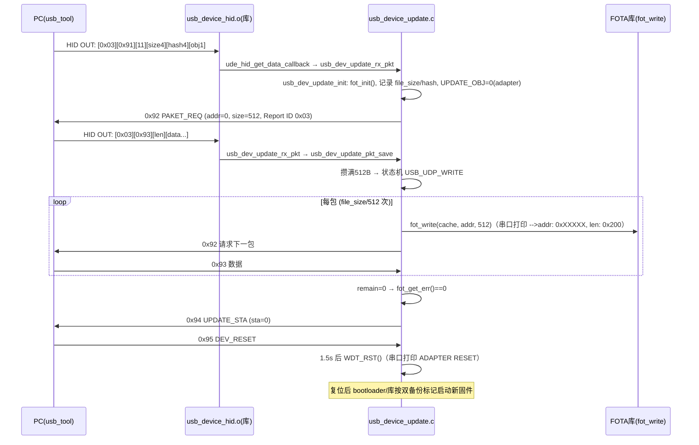

# AB5712F USB HID OTA 升级原理与代码说明

> 适用工程：`app/projects/microphone`（CONFIG_CLIP_LE_MIC），升级开关 `ADAPTER_USB_UPDATE_EN=1`（config_clip_mic.h:137）。
> 本文所有结论均有仓库内代码/日志证据；未经证实处标注【未确认】。
> 配套测试记录见 `docs/test/OTA测试记录.md`。

## 1. 升级通道概述

PC 上位机（`usb_tool.exe`）通过 **USB HID 厂商自定义接口** 与设备（AB5712F 适配器/接收端）通信，把 FOT 升级文件按 512 字节/包推给设备，设备用 FOTA 双备份机制（闭源库 `fot_write`）写入 flash，全部收完后上位机发复位命令，设备软复位运行新固件。

- 协议文档：本目录 `HID升级协议.docx`
- 上位机：`usb_tool1.1_20241205/usb_tool.exe`（源码 `USB_TOOL1.0源码/`，Qt + hidapi，枚举所有 HID 设备不过滤 VID/PID）
- 升级文件：FOT 格式（原厂工具生成），文件头 `FOT\x00` magic + 大小 + MD5 + `ZOOM` 标记；**app.dcf/app.bin 不是升级文件**（dcf 是 xmaker 下载打包文件）

## 2. USB HID 接口形态（实测）

设备枚举为 USB Composite Device（VID 0x0C21 / PID 0x0124，config_clip_mic.h:383-384），产品名 `USB Mirophone`（:371）。复合设备含 4 个 HID 顶层 collection（从 `libdrivers.a(usb_device_hid.o)` 描述符数据解出）：

| Report ID | Count | Usage Page | 用途 |
|---|---|---|---|
| 0x06 | 0x09 | 0x000C（Consumer） | 音量/播放控制键 |
| 0x07 | 0x02 | 0x000B（Telephony） | 电话键 |
| **0x03** | 0x40 | **0xFF90（厂商自定义）** | **OTA 升级通道（IN/OUT 各 64B）** |
| 0x41 | 0x40 | 0xFF82（厂商自定义） | 厂商自定义【用途未确认，升级实测走 0x03】 |

usb_tool 中选择 **Usage Page 0xff90（Report ID 0x03）** 的"USB Mirophone"条目连接。

## 3. 协议命令（HID升级协议.docx + 代码一致）

每次 HID 传输 65 字节：`[Report ID][Cmd][Payload_len][Payload...]`。设备端解析在 `usb_dev_update_rx_pkt()`（usb_device_update.c:157），注意 `cmd = ptr[1]`、`payload_len = ptr[2]`，即 ptr[0] 是 Report ID。

| 命令 | 值 | 方向 | Payload |
|---|---|---|---|
| UPDATE_REQ | 0x91 | PC→设备 | FILE_SIZE(4B) + FILE_HASH(4B) + UPDATE_OBJ(1B，0=adapter，1=device) |
| PAKET_REQ | 0x92 | 设备→PC | ADDR(4B) + PAKET_SIZE(4B)，设备拉数据 |
| PAKET_RSP | 0x93 | PC→设备 | 512B 数据（payload_len 字节） |
| UPDATE_STA | 0x94 | 设备→PC | UPDATE_OBJ(1B) + STA(1B，0=成功) |
| DEV_RESET | 0x95 | PC→设备 | 无，设备 1.5s 后软复位（usb_device_update.c:147） |

FILE_HASH = 整个 FOT 文件 MD5 的前 4 字节（实测 rx_ota.fot MD5 前 4 字节 a3c247c0 与串口 `file_hash` 打印一致）。【未确认】设备侧未发现校验该 hash 的代码分支。

## 4. 代码地图

| 文件 | 作用 |
|---|---|
| `app/modules/usb_device/usb_device_update.c` | 升级主逻辑：0x91 解析、拉包状态机、`fot_write` 写 flash、0x94/0x95 应答。整体在 `#if ADAPTER_USB_UPDATE_EN` 内 |
| `app/modules/usb_device/usb_device_update.h` | 对外声明。`usb_device_hid_send_user(report_id, data, len, type)` 为库函数，type 用 `usb_device_iap2.h:52-55` 的 `NORMAL_DATA=0`/`FOTA_DATA=1`（FOTA_DATA=带 Report ID 前缀，63B 数据） |
| `app/functions/func_adapter.c:391-393` | 主循环轮询 `usb_dev_update_process()` |
| `app/libs/bt8930/libdrivers.a(usb_device_hid.o)` | 库：HID 描述符、`ude_hid_send`（300ms 超时静默丢弃，【未确认】细节）、`ude_hid_get_data_callback` → 直接转发 `usb_dev_update_rx_pkt`（原厂提供截图） |
| `app/libs/bt8930/api_update.h` | FOTA API：`fot_init/fot_write/fot_get_err`，错误码枚举 `FOT_ERR_ENUM`（1=无升级，11=CRC 校验失败等） |
| `app/projects/microphone/port/port_update.c` | `updateset_reset()` 复位策略钩子 |
| `app/projects/microphone/config_clip_mic.h:137` | `ADAPTER_USB_UPDATE_EN` 总开关 |

关键修改记录（2026-09-22，打通时改的）：
- reporter_id 0x55 → **0x03**（usb_device_update.c 三处）。0x55 不在 HID 描述符里，Windows HID 驱动拒发，是首次测试进度 0% 的根因。
- `usb_device_hid_send_user` 补第 4 参数 `FOTA_DATA`（usb_device_update.h:19 原声明少参，调用会传栈垃圾值）。

## 5. 升级流程

状态机（`USB_DEV_UPDATE_STA`，usb_device_update.c:29-40）：
`INIT → (收0x91) → IDLE →(发0x92)→ 收0x93攒包 → WRITE(fot_write) → IDLE... → FINISH（全部完成）`；
`DEV_RESET` 状态停留 1500ms 后 `WDT_RST()` 复位。

写 flash 走 FOTA 双备份：`fot_write` 由闭源库实现，`-->fot update ok` 且 `fot_get_err()==0` 表示写入+校验通过。【双备份分区布局未确认，需原厂文档】

## 6. 关键打印对照

| 串口打印 | 位置 | 含义 |
|---|---|---|
| `usb_dev_update_init adapter` | usb_device_update.c:280 | 收到 0x91，角色=adapter |
| `file_size: xxx` / `file_hash: xxx` | :293-294 | 升级文件大小/MD5 前 4 字节 |
| `adapter ota` | :199 | 每收到一包 0x93（每次 USB 传输，512B 分多次到） |
| `-->addr: 0x51200, len: 0x200` | 库（fot_write 内部） | 每写满 512B 打印一次 |
| `-->fot update ok` | :88 | 全部写入且校验通过 |
| `usb_dev_update_reset` + `ADAPTER RESET` | :250, :148 | 收到 0x95，1.5s 后复位 |
| `EVT_PC_INSERT/EVT_PC_REMOVE` | usb 检测 | USB 插拔 |

## 7. 已知限制与未确认项

1. UPDATE_OBJ=1（升级对端 device 端）：需 `ADAPTER_AB_FOT_DEVICE_SUPPORT=1` 且麦端具备被升级实现，当前=0。【未确认】本方案是否需要该功能。
2. FILE_HASH 设备侧校验：代码只解析未使用，【未确认】是否依赖库内部校验（`fot_get_err` 的 CRC 校验是 flash 数据校验）。
3. 断点续传：USB HID 路径代码中未见（FOTA 路径有 `fot_breakpoint_info_read`），升级中拔线预期重新升级。
4. 0x41（0xFF82）接口用途、双备份 flash 布局、FOT 文件打包工具的来源说明：需原厂补充。
