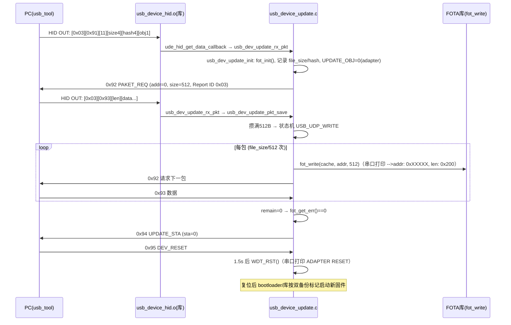
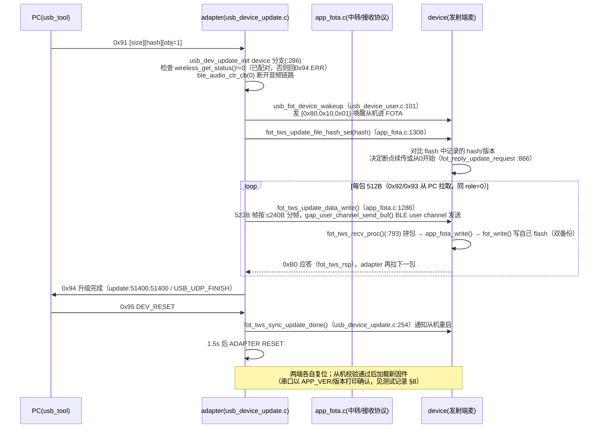

# AB5712F USB HID OTA 升级原理与代码说明

> 适用工程：`app/projects/microphone`（CONFIG_CLIP_LE_MIC），升级开关 `ADAPTER_USB_UPDATE_EN=1`（config_clip_mic.h:137）。
> 本文所有结论均有仓库内代码/日志证据；未经证实处标注【未确认】。
> 配套测试记录见 `docs/test/OTA测试记录.md`。

## 1. 升级通道概述

PC 上位机（`usb_tool.exe`）通过 **USB HID 厂商自定义接口** 与设备（AB5712F 适配器/接收端）通信，把 FOT 升级文件按 512 字节/包推给设备，设备用 FOTA 双备份机制（闭源库 `fot_write`）写入 flash，全部收完后上位机发复位命令，设备软复位运行新固件。

- 协议文档：本目录 `HID升级协议.docx`
- 上位机：`usb_tool1.1_20241205/usb_tool.exe`（源码 `USB_TOOL1.0源码/`，Qt + hidapi，枚举所有 HID 设备不过滤 VID/PID）
- 升级文件：FOT 格式（原厂工具生成），文件头 `FOT\x00` magic + 大小 + MD5 + `ZOOM` 标记；**app.dcf/app.bin 不是升级文件**（dcf 是 xmaker 下载打包文件）

## 2. USB HID 接口形态（实测）

设备枚举为 USB Composite Device（VID 0x0C21 / PID 0x0124，config_clip_mic.h:383-384），产品名 `USB Mirophone`（:371）。复合设备含 4 个 HID 顶层 collection（从 `libdrivers.a(usb_device_hid.o)` 描述符数据解出）：

| Report ID | Count | Usage Page | 用途 |
|---|---|---|---|
| 0x06 | 0x09 | 0x000C（Consumer） | 音量/播放控制键 |
| 0x07 | 0x02 | 0x000B（Telephony） | 电话键 |
| **0x03** | 0x40 | **0xFF90（厂商自定义）** | **OTA 升级通道（IN/OUT 各 64B）** |
| 0x41 | 0x40 | 0xFF82（厂商自定义） | 厂商自定义【用途未确认，升级实测走 0x03】 |

usb_tool 中选择 **Usage Page 0xff90（Report ID 0x03）** 的"USB Mirophone"条目连接。

**描述符源头确认（2026-09-23，原厂提供源码截图）**：上述报告描述符定义在原厂源码 `usb_device_table.c` 的 `const u8 desc_hid_report[231]` 数组中，随 libdrivers.a 编译进固件。截图内容与库二进制中解出的 230 字节**逐字节一致**（声明 [231] 是数组容量，实际初始化 230 字节）。关键片段（0xff90 collection）：

```c
0x06, 0x90, 0xFF,   // Usage Page (Vendor Defined 0xFF90)
0x09, 0x01,         // Usage (0x01)
0xA1, 0x01,         // Collection (Application)
0x09, 0x03,         //   Usage (0x03)
0x85, 0x03,         //   Report ID (3)          ← PC 读到的 Reporter ID 来源
0x15, 0x00,         //   Logical Minimum (0)
0x26, 0xFF, 0x00,   //   Logical Maximum (255)
0x75, 0x08,         //   Report Size (8)
0x95, 0x3F,         //   Report Count (63)      ← usb_tool 的 reporter_count = 0x3F+1 = 0x40
0x82, 0x02, 0x01,   //   Input (Data,Var,Abs,Buffered Bytes)   ← 设备→PC，63B
0x09, 0x04,         //   Usage (0x04)
...                 //   Output 63B
0xC0,               // End Collection
```

（0xFF82 collection 同样结构，Report ID=0x41，Input/Output 各 63B。）即 Report ID 0x03 是原厂在该数组中定义的固定值，与固件应用代码无关。

## 3. 协议命令（HID升级协议.docx + 代码一致）

每次 HID 传输 64 字节（描述符定义 Report ID 1B + Report Count 0x3F×8bit=63B）：`[Report ID][Cmd][Payload_len][Payload...]`，有效 payload 最多 61 字节；512B 数据包由多次 0x93 传输拼齐。设备端解析在 `usb_dev_update_rx_pkt()`（usb_device_update.c:157），注意 `cmd = ptr[1]`、`payload_len = ptr[2]`，即 ptr[0] 是 Report ID。

| 命令 | 值 | 方向 | Payload |
|---|---|---|---|
| UPDATE_REQ | 0x91 | PC→设备 | FILE_SIZE(4B) + FILE_HASH(4B) + UPDATE_OBJ(1B，0=adapter，1=device) |
| PAKET_REQ | 0x92 | 设备→PC | ADDR(4B) + PAKET_SIZE(4B)，设备拉数据 |
| PAKET_RSP | 0x93 | PC→设备 | 512B 数据（payload_len 字节） |
| UPDATE_STA | 0x94 | 设备→PC | UPDATE_OBJ(1B) + STA(1B，0=成功) |
| DEV_RESET | 0x95 | PC→设备 | 无，设备 1.5s 后软复位（usb_device_update.c:147） |

FILE_HASH = 整个 FOT 文件 MD5 的前 4 字节（实测 rx_ota.fot MD5 前 4 字节 a3c247c0 与串口 `file_hash` 打印一致）。【未确认】设备侧未发现校验该 hash 的代码分支。

## 4. 代码地图

| 文件 | 作用 |
|---|---|
| `app/modules/usb_device/usb_device_update.c` | 升级主逻辑：0x91 解析、拉包状态机、`fot_write` 写 flash、0x94/0x95 应答。整体在 `#if ADAPTER_USB_UPDATE_EN` 内 |
| `app/modules/usb_device/usb_device_update.h` | 对外声明。`usb_device_hid_send_user(report_id, data, len, type)` 为库函数，type 用 `usb_device_iap2.h:52-55` 的 `NORMAL_DATA=0`/`FOTA_DATA=1`（FOTA_DATA=带 Report ID 前缀，63B 数据） |
| `app/functions/func_adapter.c:391-393` | 主循环轮询 `usb_dev_update_process()` |
| `app/libs/bt8930/libdrivers.a(usb_device_hid.o)` | 库：HID 描述符、`ude_hid_send`（300ms 超时静默丢弃，【未确认】细节）、`ude_hid_get_data_callback` → 直接转发 `usb_dev_update_rx_pkt`（原厂提供截图） |
| `app/libs/bt8930/api_update.h` | FOTA API：`fot_init/fot_write/fot_get_err`，错误码枚举 `FOT_ERR_ENUM`（1=无升级，11=CRC 校验失败等） |
| `app/projects/microphone/port/port_update.c` | `updateset_reset()` 复位策略钩子 |
| `app/projects/microphone/config_clip_mic.h:137` | `ADAPTER_USB_UPDATE_EN` 总开关 |

关键修改记录（2026-09-22，打通时改的）：
- reporter_id 0x55 → **0x03**（usb_device_update.c 三处）。0x55 不在 HID 描述符里，Windows HID 驱动拒发，是首次测试进度 0% 的根因。
- `usb_device_hid_send_user` 补第 4 参数 `FOTA_DATA`（usb_device_update.h:19 原声明少参，调用会传栈垃圾值）。

## 5. 升级流程



状态机（`USB_DEV_UPDATE_STA`，usb_device_update.c:29-40）：
`INIT → (收0x91) → IDLE →(发0x92)→ 收0x93攒包 → WRITE(fot_write) → IDLE... → FINISH（全部完成）`；
`DEV_RESET` 状态停留 1500ms 后 `WDT_RST()` 复位。

写 flash 走 FOTA 双备份：`fot_write` 由闭源库实现，`-->fot update ok` 且 `fot_get_err()==0` 表示写入+校验通过。【双备份分区布局未确认，需原厂文档】

### 5.1 role=1：升级 device 端（发射端麦克风）的原理

0x91 的 UPDATE_OBJ=1 时，PC 插的仍然是 **adapter**（发射端麦没有 USB 口），adapter 只做**中转**，升级数据经无线链路写入发射端麦自己的 flash。**两块开发板都要上电且已完成无线配对**。adapter 自身不会被升级（role=1 不调 `fot_write` 写本地；两端都要更新时先 role=0 升 adapter、复位后再 role=1 升 device）。

开关与前提：
- `ADAPTER_USB_UPDATE_EN=1`（升级主开关）+ `ADAPTER_AB_FOT_EN=1` + `ADAPTER_AB_FOT_DEVICE_SUPPORT=1`（config_clip_mic.h:137/143/144）；后两个打开后 comm RAM 不足，`ram.ld` 增加 `__comm_ram_size` 109k→113k 分支（从空余的 adapter 区借 4k）。
- 运行角色由**烧录参数区**决定（与编译无关）：`xcfg_init()`（system.c:694）读参数区 → `wireless_mic_role_init()`（wireless_proc.c:221）→ `func_run()`（func.c:238）。发射端必须用 `wireless_mic_emit` 配置烧录参数，开机打印 **`load_code(0)` + `func_device`**（adapter 为 `load_code(1)` + `func_adapter`）。
- 【实测不需要】按键进升级模式：`fot_update_en_switch()`（bsp_usbfot.c:27，USB Storage 升级模式入口）在本工程无任何调用者。

数据链路（接收端 adapter → 发射端 device）：



接收侧闭环依据：`libbtstack.a(gap_proc.o)` 存在对 `tws_set_fot_data` 的未定义引用，即 BLE user channel 收到的数据由 `app_fota.c:845 tws_set_fot_data()` 接管，无需应用层额外接线。

实测注意（详见测试记录 §8）：
- 升级过程中 `ERROR ======> timer_thread miss: pcm` 为音频线程超时的伴生打印，属正常；
- **两端务必升到同一份源码编译的同版本固件**，只升一端出现过链路建立后立即掉线的情况（§8.2/§8.4）。

## 6. 关键打印对照

| 串口打印 | 位置 | 含义 |
|---|---|---|
| `usb_dev_update_init adapter` | usb_device_update.c:280 | 收到 0x91，角色=adapter |
| `usb_dev_update_init device` | :288 | 收到 0x91，角色=device（adapter 进入中转模式） |
| `file_size: xxx` / `file_hash: xxx` | :293-294 | 升级文件大小/MD5 前 4 字节 |
| `adapter ota` | :199 | role=0：每收到一包 0x93（每次 USB 传输，512B 分多次到） |
| `device ota` | :207 | role=1：每收到一包 0x93（攒包准备转发） |
| `-->addr: 0x51200, len: 0x200` | 库（fot_write 内部） | role=0 每写满 512B 打印一次；role=1 时出现在**device 端**（device 自己写 flash） |
| `update:51400, 51400` + `USB_UDP_FINISH` | usb_device_update.c:138-139 | role=1：device 转发完成（地址==文件大小） |
| `-->fot update ok` | :88 | role=0：全部写入且校验通过 |
| `usb_dev_update_reset` + `ADAPTER RESET` | :250, :148 | 收到 0x95，1.5s 后复位（两端都会复位） |
| `load_code(1)`+`func_adapter` / `load_code(0)`+`func_device` | wireless_proc.c:247/250, func.c | 复位后角色判别：1=adapter，0=device（由参数区决定） |
| `EVT_PC_INSERT/EVT_PC_REMOVE` | usb 检测 | USB 插拔 |
| `ERROR ======> timer_thread miss: pcm` | libplatform（线程监控） | OTA 期间音频线程超时，升级过程伴生现象，不影响结果 |

## 7. 已知限制与未确认项

1. ~~UPDATE_OBJ=1（升级对端 device 端）~~：✅ 已打通（2026-09-22），需 `ADAPTER_AB_FOT_EN=1` + `ADAPTER_AB_FOT_DEVICE_SUPPORT=1` + `ram.ld` comm 109k→113k，原理见 §5.1，测试见测试记录 §8。
2. FILE_HASH 设备侧校验：代码只解析未使用，【未确认】是否依赖库内部校验（`fot_get_err` 的 CRC 校验是 flash 数据校验）。
3. 断点续传：USB HID 路径（role=0）代码中未见；role=1 的 device 侧 app_fota 有断点续传逻辑（`fot_reply_update_request` 对比 hash/版本恢复 `fot_var.addr`），USB HID 拉包端【未确认】是否配合续传。
4. 0x41（0xFF82）接口用途、双备份 flash 布局（与参数区关系）、FOT 文件打包工具的来源说明：需原厂补充。
5. 一拖二（双麦）时 role=1 的双索引（`gap_user_channel_send_buf(0/1,...)`）广播/应答行为：【未确认】需实测。

## 8. FAQ

### Q1：PC 上位机（usb_tool）如何识别 adapter 和 device？

**上位机不识别、也不需要识别。** 依据源码（`USB_TOOL1.0源码/usb_tool/mainwindow.cpp`）：

- usb_tool 始终只跟 **USB 插着的设备**（即 adapter）通信——`hid_enumerate(0,0)` 枚举所有 HID 接口（不过滤 VID/PID，:60），用户在下拉框选中 0xff90/Report ID 0x03 那条后 `hid_open_path()` 打开（:137）。
- 升级对象由**两个按钮**区分：`on_btn_update_adapter_clicked()` 发 `update_obj=0`（:465），`on_btn_update_dev_clicked()` 发 `update_obj=1`（:523）。也就是"升级谁"是**人点哪个按钮**告诉固件的，1 字节参数随 0x91 下发。
- 固件侧把结果**原样回显**：0x94 的 payload 里带 `update_obj + status`（usb_device_update.c:218 `usb_dev_update_sta_rsp`），上位机按 `update_obj` 显示"Adapter 升级成功"还是"Device 升级成功"（mainwindow.cpp:244-263）。所以工具界面上看到"Device 升级成功"只说明固件报告了 obj=1 的结果，不代表工具知道 device 在哪里。

链路记忆：`role=0`：PC↔adapter 直升；`role=1`：PC↔adapter（中转）↔无线↔device——USB 那一端永远是 adapter。

### Q2：连接/初始化时上位机发了什么数据？

连接阶段（`device_connect()`，mainwindow.cpp:84-179）**不发任何业务命令**，只做三件事：

1. `hid_open_path()` 打开选中的 HID 接口；
2. `hid_get_report_descriptor()` 读报告描述符，从中解析两个参数（:151-157）：
   - 遇到 `0x85`（Report ID 标签）→ 取后一字节为 `reporter_id`（本设备=0x03）；
   - 遇到 `0x95`（Report Count 标签）→ 取后一字节 `+1` 为 `reporter_count`（本设备描述符 Report Count=0x3F，故 0x3F+1=0x40=64，即 1 字节 Report ID + 63 字节数据）。
3. `hid_set_nonblocking(1)` + 试读一次 `hid_read()`（:160）：读失败（返回<0，Windows 下多为无权限访问该接口）则判定"设备拒绝访问"自动断开；成功则显示 `Reporter ID/Count`。

之后所有收发都按 `reporter_count`（0x40=64 字节）定长进行：`hid_write(handle, data, 64)` / `hid_read(handle, buf, 64)`（1 字节 Report ID + 63 字节数据）。

第一条业务数据是**用户点升级按钮时**的 0x91（见 §3 命令表）：`[0x03][0x91][9][size4][hash4][obj1]`——固件从这一刻才进入升级流程（`usb_dev_update_init`）。所谓"初始化握手"就只有这一条 0x91，没有其它探测/版本交换命令。

### Q3：为什么设备列表里有很多条目？怎么选？

`hid_enumerate(0,0)` 不过滤 VID/PID，把 PC 上所有 HID 接口（键盘、鼠标、其他 USB 设备的每个 collection）都列出来。本设备是复合设备，自身就占 4 条（0x06/0x07/0x03/0x41，见 §2）。**选 VID 0x0c21 且 Usage Page 0xff90 的 "USB Mirophone" 条目**；0x41（0xff82）实测发 0x91 无响应。

### Q4：连接后显示的 `Reporter ID: 0x03` / `Reporter Count: 0x40` 是什么？是设备发的吗？是固定的吗？

**不是设备运行时发的，是设备的 HID 报告描述符里的固定值，usb_tool 是"读描述符解析"出来的**（mainwindow.cpp:150-157）：

- 连接时工具调 `hid_get_report_descriptor()` 把设备的报告描述符整段读回来（这段描述符编译在 `libdrivers.a(usb_device_hid.o)` 里，是 USB 枚举时主机就已经拿到的静态数据）；
- 扫描描述符字节流：遇到 **`0x85`（Report ID 标签）**取后一字节 → `Reporter ID: 0x03`；遇到 **`0x95`（Report Count 标签）**取后一字节 **+1** → `Reporter Count: 0x40`（描述符里写的是 0x3F=63 字节数据 +1 字节 Report ID = 64 字节定长包）；
- 解析结果只取决于描述符内容。注意工具扫描的是**整个描述符**，多个 collection 时 `reporter_id` 会被后面出现的 Report ID 覆盖——本设备 0xff90 的 collection 恰好排在最后，所以最终留下的是 0x03（这也是工具作者按自己的描述符布局写的简化逻辑，选 0x03 条目连接时结果恰好正确）。

从库中描述符二进制可直接验证（0xff90 collection）：`85 03`（Report ID=3）、`75 08`（Size=8bit）、`95 3F`（Count=63）、`81 02`（Input，即 IN 通道 63B）、`91 01`（Output，即 OUT 通道 63B）——与 §2 接口表完全一致。

**是否固定**：对这个固件/这套库来说是固定的（描述符是编译期常量）；但它是"这个设备"的属性，不是 HID 协议规定——原厂换描述符（比如改成别的 Report ID 或长度）这些值就会变。

### Q5：为什么之前固件里 reporter_id 0x55 → 0x03 就能升级成功？原理是什么？

这是**两个方向、各自独立**的问题，改 0x03 解决的是"设备→PC"方向：

1. **PC→设备方向从来就不是问题**。上位机发数据时 `hid_write` 的第一个字节填 `reporter_id`（mainwindow.cpp:449 等），而 `reporter_id` 是工具**从设备描述符里读出来的**（Q4）——所以不管固件代码里写什么，PC 发的 Report ID 始终是描述符里的 0x03。设备端收数据也不看代码里的常量：库 `ude_hid_get_data_callback` 按 USB 端点收到的实际 Report ID 分发，`usb_dev_update_rx_pkt()` 拿到的就是有效命令。这就是为什么第一轮测试发 0x91 固件能收到、串口能打 `usb_dev_update_init`。

2. **设备→PC 方向是坏的**。固件应答（0x92 拉包请求等）用 `usb_device_hid_send_user(reporter_id, ...)` 主动发送，这个 `reporter_id` 是**固件代码里的常量**（原厂代码写死 0x55）。Windows HID 驱动对 IN 报文做校验：Report ID 必须存在于设备描述符中，否则**静默丢弃**。0x55 在描述符里不存在（本设备只有 0x06/0x07/0x03/0x41），于是设备发的每一帧 0x92 都被 Windows 拒之门外——PC 等不到拉包请求，进度条永远 0%，而设备串口看起来一切正常（`usb_dev_update_init` 正常打印），两端互不知情。

3. 把固件里三处常量 0x55 改成 **0x03**（描述符里真实存在的那个 collection）后，设备的 IN 报文通过了 Windows 校验，`ude_hid_send` 能真正送到 usb_tool，0x92→0x93 的拉包循环建立，升级就通了。

一句话总结：**PC 发送用"它从描述符读到的 ID"，设备发送用"代码里写死的 ID"——两个 ID 必须都落在描述符定义的合法集合里；0x55 只出现在代码里、不在描述符里，所以只有设备→PC 方向断掉。** 这也解释了当时"收到 0x91 却无进度"的诡异现象。

### Q6：为什么 PC 读到的是 0x03？这跟固件代码无关吗？PC 具体怎么读的？

**0x03 确实跟固件 C 代码无关——它来自设备的 HID 报告描述符，而这份描述符在库里（`libdrivers.a(usb_device_hid.o)`），是编译期写进二进制的常量数组。** 固件的 `.c` 文件里没有这份描述符（只有闭源库里有），所以"改代码里的常量"（如 0x55→0x03）影响的只是固件**主动发送**时填的字节，改不了描述符本身。0x03 之所以"合法"，是因为库里描述符的 0xff90 collection 写了 `85 03`（Report ID=3）——这是原厂生成固件时就定死的。

PC 端读取链路（usb_tool → hidapi → Windows 系统调用，全部有源码依据）：

1. `hid_open_path()` 打开设备后，工具调 `hid_get_report_descriptor()`（mainwindow.cpp:140）。
2. hidapi 的 Windows 实现（hid.c:1548）**并不能直接拿到原始描述符**：Windows 把枚举时读到的描述符解析成内部结构 `PHIDP_PREPARSED_DATA`（预解析数据，由系统在设备枚举时通过 HID 类驱动从设备的 Report Descriptor 生成），`HidD_GetPreparsedData()` 拿到的就是这个。
3. 因为 Windows 不再提供原始字节，hidapi 用 `hid_winapi_descriptor_reconstruct_pp_data()`（hidapi_descriptor_reconstruct.c:181）**从预解析数据反向重构出一份等价的描述符**：遍历 caps/LinkCollection，遇到不同 Report ID 就写回一条 Report ID 项（:727/:872，全局项标签 `rd_global_report_id = 0x84`，hidapi_descriptor_reconstruct.h:58）。
4. 工具再扫这份重构出来的描述符字节流：`0x85` 后一字节 → `reporter_id=0x03`；`0x95` 后一字节+1 → `reporter_count=0x40`。

所以完整链路是：

```
固件编译期: 库里的描述符常量(85 03, 95 3F, ...)
   ↓ USB 枚举时设备上报给 Windows
Windows HID 类驱动: 解析成 PreparsedData（每个 Report ID/长度在这里定型）
   ↓ HidD_GetPreparsedData()
hidapi: 反向重构描述符（0x85 03, 0x95 3F 重新写回字节流）
   ↓ hid_get_report_descriptor()
usb_tool: 扫描字节流 → reporter_id=0x03, reporter_count=0x3F+1=0x40
```

要点：**0x03 的源头是库里描述符的 `85 03`；Windows/hidapi/usb_tool 都只是搬运和解析，不会发明新值。** `hid_write` 发送时把 0x03 填在首字节只是"按描述符声明的格式填包"，Windows 校验也拿同一份 PreparsedData 比对——这就是为什么 PC→设备方向永远合法，而固件写死 0x55 的设备→设备→PC 方向被丢。
