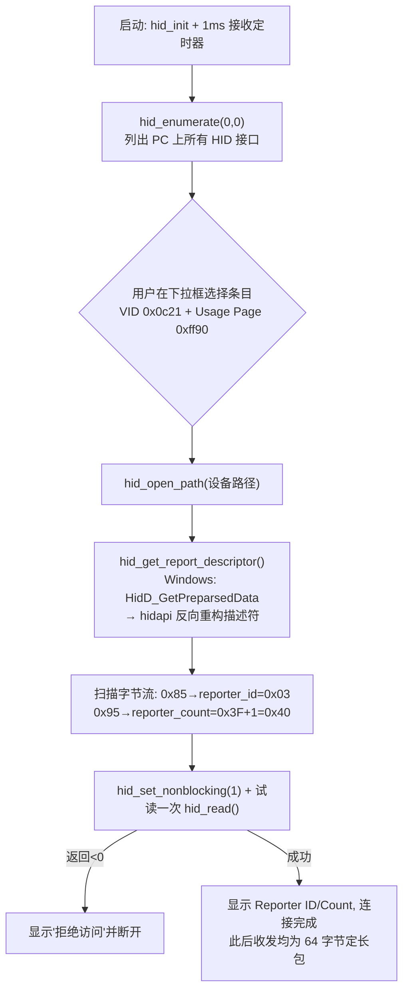
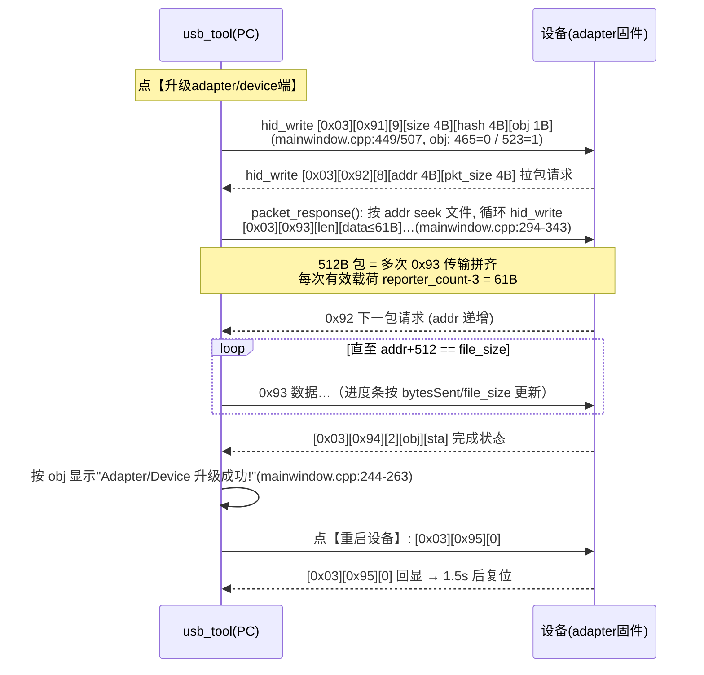
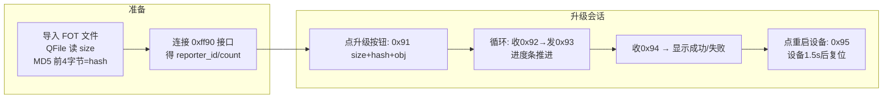
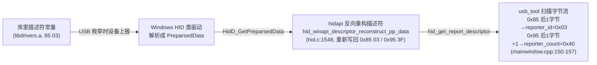

# PC 上位机（usb_tool）工作原理

> 源码：`docs/peripheral/OTA/USB_TOOL1.0源码/USB_TOOL1.0/usb_tool/`（Qt + hidapi，`mainwindow.cpp` 约 560 行）
> 本文所有结论均标注源码文件:行号；未经证实处标【未确认】。
> 配套文档：`OTA原理与代码说明.md`（固件侧原理与 FAQ）。

## 1. 总体架构

usb_tool 是单窗口 Qt 程序，围绕 hidapi 的两个阻塞式 API 工作：

| 要素 | 实现 | 源码位置 |
|---|---|---|
| 设备枚举 | `hid_enumerate(0,0)` 列出所有 HID 接口（不过滤 VID/PID），填下拉框 | mainwindow.cpp:60 |
| 连接 | `hid_open_path()` + 读描述符解析参数 + 试读一次 | mainwindow.cpp:84-179 |
| **发送** | `hid_write(deviceHandle, data, reporter_count)`（Windows 下最终走 `WriteFile`） | hid.c:1106 |
| **接收** | `hid_read()` 非阻塞轮询（Windows 下走 `ReadFile`），**1ms QTimer 定时器驱动** | mainwindow.cpp:29-31, hid.c:1169 |
| 文件解析 | `QFile` 读 FOT 大小 + `QCryptographicHash::Md5` 前 4 字节作 hash | mainwindow.cpp:365-412 |
| 协议命令 | 枚举 `CMD_UPDATE_REQ=0x91 / PAKET_REQ / PAKET_RSP / UPDATE_STA / DEV_RESET`（与固件一致） | mainwindow.cpp:5-10 |

关于"发 0x41 / 收 0x03"的说法——**与源码不符，实际收发都用同一个 `reporter_id`（0x03）**：`hid_write` 每次把 `data[0] = reporter_id`（mainwindow.cpp:301/449/507/556），`hid_read` 读回的缓冲首字节也是 Report ID（`processHIDData` 先解析它，mainwindow.cpp:209）。工具中没有任何针对 0x41 的代码（全文搜不到）。0x41/0x03 是设备**两个不同的 HID 接口**（见下节），选中哪个接口条目就通哪个，不存在"一收一发分用两个 ID"的机制。之前实测"连 0x41 无响应"是因为 0x41 接口（0xff82 页）上固件没有升级命令处理，不是工具的收发分离设计。

## 2. 连接流程：识别设备与 Report ID

要点（详见 OTA原理与代码说明.md §8 Q4/Q6）：

- `reporter_id` / `reporter_count` 不是设备运行时发的，是**设备的 HID 报告描述符**（编译在 libdrivers.a 里）经 Windows 预解析数据重构出来的静态值：0xff90 collection 定义 `Report ID=0x03`、每报告 1B ID + 63B 数据 = 64B；
- 工具扫描的是重构后的整份描述符，多 collection 时 `reporter_id` 会被后面的 ID 覆盖——本设备 0xff90 collection 恰在最后，所以连 0x03 条目时结果恰好正确；
- 连接阶段**不发任何业务命令**，第一条业务数据是用户点升级按钮时的 0x91。

## 3. 升级会话：拉包（设备主控）模型

升级的节奏**由设备端驱动**：上位机点按钮只发一条 0x91 启动命令，之后是"设备要、上位机给"的拉包循环，上位机从不主动推数据。

### 3.1 发送侧细节（0x93 数据包，mainwindow.cpp:294-343）

- 缓冲 `data[256]`，`data[0]=reporter_id`、`data[1]=CMD_PKT_RSP(0x93)`；
- 每次 `payload_len = min(剩余, reporter_count-3)` = **min(剩余, 61)**——64 字节定长包扣掉 ID/CMD/LEN 头 3 字节；
- `hid_write(deviceHandle, data, reporter_count)` 固定写 64 字节（hidapi 内部不足 `OutputReportByteLength` 会补零，hid.c:1085-1096）；
- 文件按 `file_addr` seek 后连续读出发送，一个 512B 逻辑包分约 9 次 HID 传输；进度条按 `bytesSent/file_size` 更新。

### 3.2 接收侧细节（1ms 轮询，mainwindow.cpp:182-196）

- `QTimer` 每 1ms 触发 `readHIDData()` → `hid_read(buf, reporter_count)`（非阻塞，无数据立即返回 0）；
- 收到数据交给 `processHIDData()`：按 `[ID][CMD][LEN][payload]` 解析，只认三种下行命令——
  - `0x92 PAKET_REQ`：取 addr/pkt_size → 调 `packet_response()` 发数据；
  - `0x94 UPDATE_STA`：取 obj/sta → 显示成功/失败；
  - `0x95 DEV_RESET`：显示"设备已复位!"；其余打印 `RX ERROR CMD`。

## 4. 完整时序（从打开工具到升级完成）

## 5. hidapi 下层（Windows）一句话原理

- `hid_write` → 内部补零到 `caps.OutputReportByteLength` 后调 **`WriteFile`**（hid.c:1106），Windows HID 驱动按首字节 Report ID 路由到对应 collection，并校验其合法性；
- `hid_read` → 非阻塞模式下 `ReadFile` + OVERLAPPED（hid.c:1169），驱动把 IN 端点数据按 PreparsedData 解析后放入读队列；**Report ID 不在描述符里的 IN 报文在这一层就被静默丢弃**（第一轮 0x55 问题）；
- `hid_get_report_descriptor` → `HidD_GetPreparsedData` + hidapi 反向重构（见 OTA原理与代码说明.md §8 Q6）。

## 6. 已知限制与未确认项

1. 工具 `hid_enumerate(0,0)` 不过滤 VID/PID，设备列表包含 PC 上所有 HID 接口，靠人工辨认选择；
2. `reporter_id` 解析取描述符中**最后一个** `0x85`，依赖 0xff90 collection 排在描述符末尾的布局，描述符变化时此简化逻辑可能失效【未确认】工具作者的预期布局；
3. 0x41 接口（0xff82 页）上是否有其他功能（如厂家私有调试通道）：固件侧未见处理代码，用途需原厂确认；
4. 工具无断点续传逻辑：升级中断后重新点按钮即从头开始（0x91 重启会话）；
5. `QCryptographicHash::Md5` 前 4 字节按大端拼成 uint32（mainwindow.cpp:400-406），与串口 `file_hash` 打印一致；固件侧是否真正校验该 hash【未确认】。

## 7. FAQ

### Q1：PC 是怎么"读到" 0x03 的？0x03 是开发板（USB HID 设备）那边固定的吗？

**0x03 是设备端固定的**——它写在设备的 **HID 报告描述符**里，这份描述符编译在闭源库 `libdrivers.a(usb_device_hid.o)` 中（字节序列 `06 90 FF, 09 01, A1 01, 09 03, 85 03, 75 08, 95 3F, 82 02 01 ...`，见 OTA原理与代码说明.md §2）。`85 03` 即 Report ID=0x03。它是枚举时由设备上报给 Windows 的静态数据，运行期不会变；只要不换库/不换描述符，任何 PC 上读到的都是 0x03。

PC 侧"读"的完整链路（每步有 hidapi 源码依据，详见 OTA原理与代码说明.md §8 Q6）：

几个要点：

1. **Windows 不直接给原始描述符字节**。枚举时 HID 类驱动已把描述符解析成内部结构 `PHIDP_PREPARSED_DATA`，`HidD_GetPreparsedData()` 拿到的是它；hidapi 用 `hid_winapi_descriptor_reconstruct_pp_data()`（hidapi_descriptor_reconstruct.c:181）从预解析数据**反向重构**出一份等价描述符，遇到每个 Report ID 就写回一条 `0x85 xx` 项（:727/:872，标签常量 `rd_global_report_id=0x84`）。
2. **usb_tool 只是扫字节流**：整段扫描重构结果，`0x85` 后一字节记为 `reporter_id`，`0x95` 后一字节 +1 记为 `reporter_count`（mainwindow.cpp:150-157）。注意该简化逻辑取的是**最后一个** 0x85——本设备 0xff90 collection 恰好排在描述符末尾，所以连 0x03 条目时结果恰好正确；若描述符布局变化，此逻辑可能取错 ID【未确认】工具作者的预期布局。
3. **PC 没有任何地方"硬编码"0x03**。工具、hidapi、Windows 都只是搬运/解析；值的唯一来源是设备描述符。同一份 usb_tool 连别的 HID 设备会解析出别的 Report ID，照样能工作。
4. 与固件 C 代码的关系：固件 `.c` 里没有这份描述符（在闭源库里），所以改应用代码常量（如 0x55→0x03）只影响固件**主动发送**时填的字节，改不了 PC 读到的值。PC 读到的值与固件发送用的值必须都落在描述符声明的 ID 集合内，否则单方向被 Windows 静默丢弃（见 OTA原理与代码说明.md §8 Q5）。

### Q2：为什么一点击连接就打印出不同的 Reporter ID（0x06/0x07/0x03/0x41）？原理是什么？

截图现象：4 个 "USB Mirophone" 条目分别连接后打印 `0x06/0x09`、`0x07/0x02`、`0x03/0x40`、`0x41/0x40`。原理分两层：

**第一层：为什么设备在列表里是 4 个条目。** 设备的 HID 报告描述符（原厂 `usb_device_table.c` 的 `desc_hid_report`）里定义了 **4 个顶层 Collection**（0x06 Consumer / 0x07 Telephony / 0x03 FF90 / 0x41 FF82）。**Windows HID 类驱动会为每个顶层 Collection 单独创建一个设备节点（PDO）**，每个都有自己的接口路径。hidapi 枚举时（hid.c:855 `CM_Get_Device_Interface_ListW` 列出所有 HID 接口 → 每个接口 `hid_internal_get_device_info`），对每个接口调 `HidD_GetPreparsedData + HidP_GetCaps` 取**该 Collection 的** UsagePage/Usage 填进条目（hid.c:757-762）——这就是下拉框每条显示的 `Usage Page 0x000C/0x000B/0xFF90/0xFF82` 的来源。4 个条目对应同一物理设备的 4 个逻辑 HID 设备。

**第二层：连接后为什么打印不同的 ID/Count。** `device_connect()` 里 `hid_get_report_descriptor()` 拿到的是**当前所连 Collection 的**预解析数据重构出的描述符片段——只含这个 Collection 自己的内容。扫描逻辑（mainwindow.cpp:150-157，取最后一个 `0x85` 为 reporter_id、最后一个 `0x95`+1 为 reporter_count）作用在这个片段上，结果自然各不相同。用原厂 `desc_hid_report` 逐个 collection 核对，与截图完全吻合：

| 连接的 Collection | 该片段内最后一个 Report ID | 最后一个 Report Count | 打印结果 |
|---|---|---|---|
| 0x06 Consumer（8+8 个 1bit 按键） | 0x85 06 | 0x95 08 → 0x08+1 | **0x06 / 0x09** ✅ |
| 0x07 Telephony（末尾 Report Count 1） | 0x85 07 | 0x95 01 → 0x01+1 | **0x07 / 0x02** ✅ |
| 0x03 FF90（63B Input/Output） | 0x85 03 | 0x95 3F → 0x3F+1 | **0x03 / 0x40** ✅ |
| 0x41 FF82（63B Input/Output） | 0x85 41 | 0x95 3F → 0x3F+1 | **0x41 / 0x40** ✅ |

要点：

1. **打印值不需要设备"发送"任何数据**——试读 `hid_read()` 只用于探测访问权限（返回<0 判拒绝），ID/Count 全部来自描述符重构结果，点击连接的瞬间就完成，与设备固件运行状态无关；
2. 4 个条目的 ID/Count 都是"真实"的——都是描述符里定义的合法值，只是各自描述的是不同 Collection；只有 **0x03 条目**背后的 FF90 collection 被固件实现了升级命令处理，所以升级必须连它；
3. 这也解释了连接 0x06/0x07 条目"成功"却不能升级：连接本身只是打开句柄+解析描述符，必然成功；后续 0x91 发出去要么 Windows 因 Report ID 不在该 collection 而拒发，要么固件不处理——两条路都走不通。
