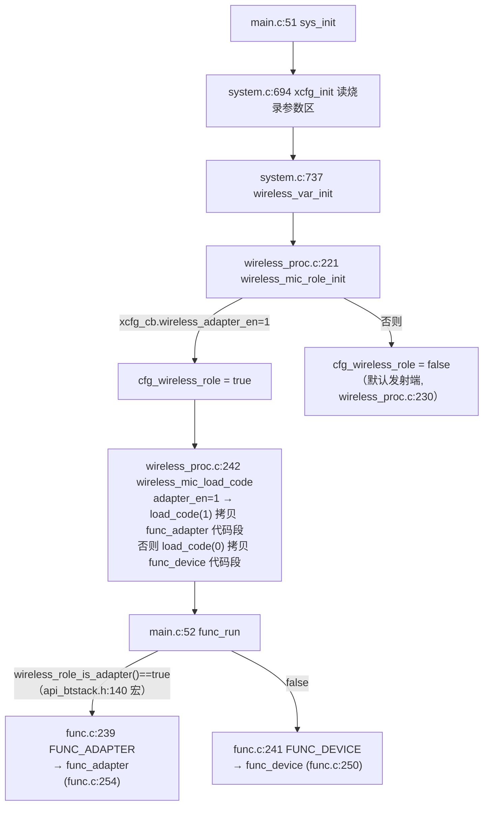
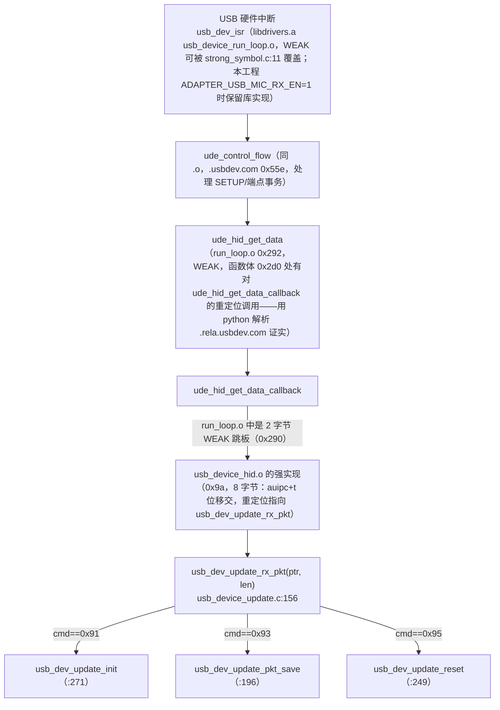
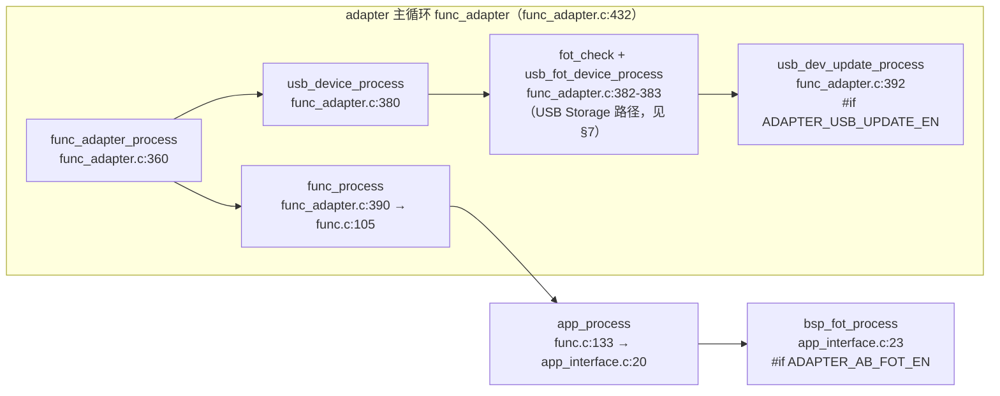
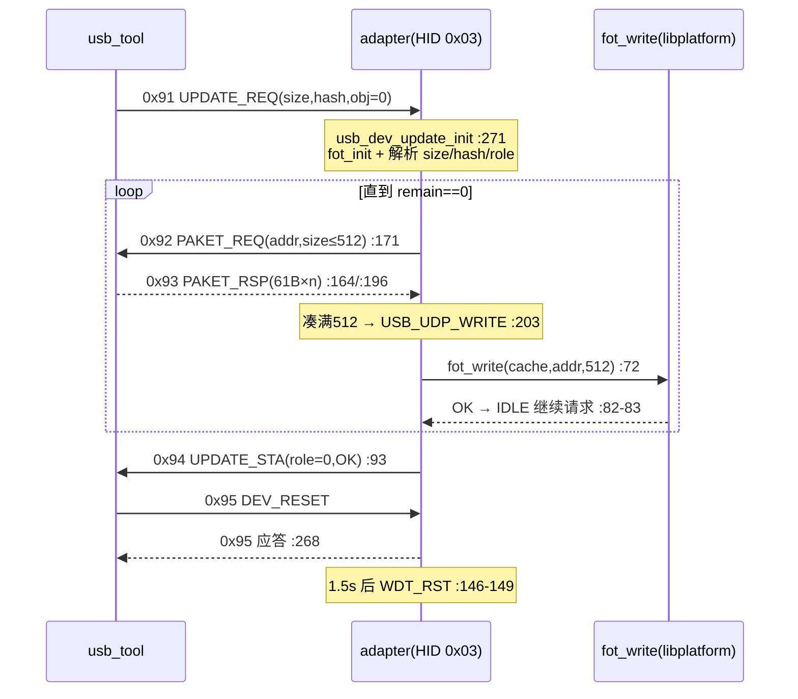
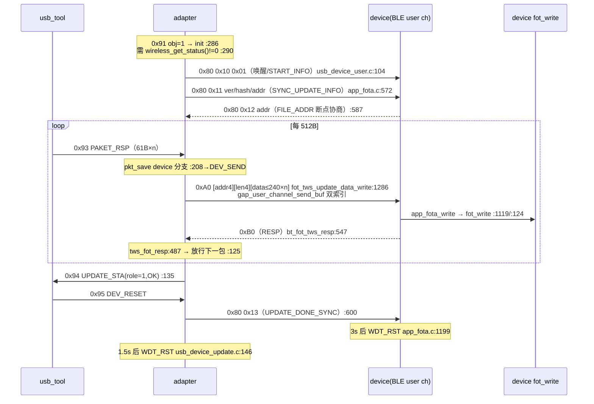

# 发送端与接收端 OTA 升级代码详解

> 本文基于当前工程（`CONFIG_CLIP_LE_MIC` 领夹麦方案，`config.h:21` → `config_clip_mic.h`）的实际代码逐行核实写成。所有结论均以 `文件:行号` 给出依据；**凡代码中查不到实据的一律标注【未确认】，不做任何命名猜测**。
>
> 术语约定（与工程代码一致）：
> - **adapter（适配器/接收端）**：`wireless_adapter_en=1` 烧录参数，运行 `func_adapter()`，USB 插 PC 那一块。
> - **device（发射端/麦克风）**：`wireless_device_en=1` 烧录参数，运行 `func_device()`，电池供电那一块。
> - 上位机：`docs/peripheral/OTA/usb_tool1.1_20241205/usb_tool.exe`（源码在 `docs/peripheral/OTA/USB_TOOL1.0源码/`）。

---

## 1. 总览：三种升级路径

| 路径 | 入口 | 涉及文件 | 本工程状态 |
|---|---|---|---|
| A. USB HID 升级 adapter | usb_tool → USB HID → `usb_dev_update_rx_pkt()`，`update_role=0` | `usb_device_update.c` | ✅ 已测通（L1/L2） |
| B. USB HID 升级 device（经 adapter 中继） | usb_tool → adapter → BLE user channel → device，`update_role=1` | `usb_device_update.c` + `usb_device_user.c` + `app_fota.c` | ✅ 已测通（L4） |
| C. USB Storage（U盘）升级 | `fot_write_start()`（usb_device_user.c:259）+ `fot_update_en_switch()`（bsp_usbfot.c:27） | `usb_device_user.c`、`bsp_usbfot.c` | ⚠️ 代码在库/工程中存在，但 `fot_update_en_switch()` 在本工程**无调用者**（grep 全树确认），触发按键未接【未确认】 |

本文第 2–5 章详解路径 A/B（即"发送端和接收端"的升级），路径 C 仅在第 7 章简述。

### 1.1 宏开关（config_clip_mic.h）

| 宏 | 行号 | 值 | 作用 |
|---|---|---|---|
| `ADAPTER_USB_UPDATE_EN` | config_clip_mic.h:137 | 1 | 启用整个 `usb_device_update.c`（没有它 `usb_dev_update_rx_pkt` 是空函数，usb_device_update.c:303） |
| `ADAPTER_AB_FOT_EN` | config_clip_mic.h:142 | 1 | 启用 `app_fota.c` 整个文件（app_fota.c:3） |
| `ADAPTER_AB_FOT_DEVICE_SUPPORT` | config_clip_mic.h:143 | 1 | 启用 device 中继升级分支（app_fota.c:463 起、usb_device_update.c:101 起等） |
| `AB_FOT_TYPE` | config_clip_mic.h:144 | `AB_FOT_TYPE_NORMAL` | FOTA 类型：裸 .fot 直写（区别于 ota_pack） |
| `ADAPTER_USB_MIC_RX_EN` | config_clip_mic.h:134 | 1 | adapter 的 USB 设备功能（`func_adapter_process()` 中 `usb_device_process()` 的编译条件，func_adapter.c:379） |

`RAM 布局`：开启 `ADAPTER_AB_FOT_DEVICE_SUPPORT` 后 comm 区溢出 3588 字节，`ram.ld:20-21` 把 `__comm_ram_size` 从 109k 借到 113k（adapter 独占区 `com_adapter`，ram.ld:70，实测只用约 0x3742c/0x59000）。

---

## 2. 运行角色判定：同一份固件如何分出发送/接收端

角色**不是编译期决定**，而是烧录参数区决定。上电链路：



- `wireless_role_is_adapter()` 是宏：`#define wireless_role_is_adapter() cfg_wireless_role`（libs/bt8930/api_btstack.h:140）。
- **开机打印判别**：`load_code(1)` + 之后出现 `func_adapter`（wireless_proc.c:247 打印 / func_adapter.c:434 打印）= adapter；`load_code(0)` + `func_device`（wireless_proc.c:250 / func_device.c:591）= device。烧录时若"保留参数区"保留了旧 role，就会出现"明明选了 emit 烧出来还是 adapter"的现象——这是 L4 测试实际踩过的坑。
- `fot_set_base_offset()` 在 `sys_init()` 之前调用（main.c:47，`#if ADAPTER_AB_FOT_DEVICE_SUPPORT`），实现在 libplatform.a(fot_update.o)（nm 确认 `T fot_set_base_offset`），作用【未确认，库闭源】，推测与升级区基地址偏移有关。

---

## 3. 公共底座：USB HID 收发（固件侧）

### 3.1 描述符与枚举

- HID 报告描述符 `desc_hid_report` 位于 **libdrivers.a(usb_device_table.o)**（map.txt:4758，`.usbdev.com.table` 段，0x228=552 字节含对齐填充）。源码级内容已与原厂截图逐字节核对（详见《OTA原理与代码说明.md》§2）：4 个 Top-Level Collection，其中 **Usage Page 0xFF90（Report ID 0x03，Report Count 0x40）** 集合承载 OTA 通道。
- 复合设备各接口的端点缓冲 `ep2_buf_out/ep2_buf_in` 由 libdrivers.a(usb_device_run_loop.o) 提供（map.txt:9704/9705，各 0x40=64 字节）。
- USB 插入检测：`usb_detect()`（func_adapter.c:327，`.com_text.usb_detect`）由系统 5ms 线程 `usr_tmr5ms_thread()` 周期调用（system.c:94/:113，`#if USB_SUPPORT_EN`），检测到 PC 插入 → `msg_enqueue(EVT_PC_INSERT)`（func_adapter.c:341，事件号 0x7f7，key_scan.h:184）→ `func_adapter_message()` 的 `case EVT_PC_INSERT`（msg_adapter.c:35）→ `usb_device_enter(UDE_ENUM_TYPE)`（msg_adapter.c:38）。

### 3.2 收包链：PC → 固件 `usb_dev_update_rx_pkt()`

USB 中断与轮询代码全部在闭源库中，以下调用关系用 `riscv32-elf-nm` 对 libdrivers.a 逐目标文件解析（含未定义符号与重定位）证实：



要点：
- `usb_device_hid.o` 中 `ude_hid_get_data_callback` 仅 8 字节（`17 03 00 00 / 67 00 03 00` = `auipc a2,0; jalr a2` 间接跳转），其重定位目标就是 `usb_dev_update_rx_pkt`——**库把 HID 收到的 64 字节 report 原样递给应用层**，应用层在 usb_device_update.c:158-159 取 `cmd=ptr[1]、payload_len=ptr[2]`（ptr[0] 是 Report ID）。
- run_loop.o 的 `ude_hid_get_data` 是 WEAK（可被强符号替换），hid.o 提供的 `ude_hid_get_data_callback` 是强符号（`T`）——两者经链接器合流，map.txt:4738（callback）/4750（get_data）可见最终地址。

### 3.3 发包链：固件 → PC

```c
usb_device_hid_send_user(u8 report_id, u8 *data, int len, int type)   // usb_device_update.h:18 声明
```
- 实现在 libdrivers.a(usb_device_hid.o)（`T usb_device_hid_send_user`，0xa2，146 字节），内部经 `ude_hid_send`（0x16）→ `ep2_buf_in`（未定义符号，nm 证实）→ USB IN 端点。
- `type` 取值：`NORMAL_DATA=0 / FOTA_DATA=1`（modules/mfi_iap2/usb_device_iap2.h:52-55）。OTA 全部用 `FOTA_DATA`。
- 发送时机由主循环驱动：`usb_device_process()`（libdrivers.a，被 func_adapter.c:380 调用）→ `usb_device_run_loop_execute` → `ude_run_loop_execute`（重定位链逐级解析证实），其中软定时器 `ude_tmr_isr`（hid.o 0x0）轮询 IN 端点缓冲把待发 report 推给 PC。

### 3.4 主循环调度（固件侧 tick 驱动）



**device 端没有 USB**，它的 OTA 推进完全靠同一条 `func_process() → app_process() → bsp_fot_process()`（func_device.c:537 → func.c:133 → app_interface.c:23）。

---

## 4. 路径 A：升级 adapter（update_role=0）

### 4.1 命令与状态机

命令集 `UPDATE_CMD`（usb_device_update.c:16-22）：0x91 UPDATE_REQ / 0x92 PAKET_REQ / 0x93 PAKET_RSP / 0x94 UPDATE_STA / 0x95 DEV_RESET。状态机 `USB_DEV_UPDATE_STA`（:24-35）。

**升级请求 0x91**（PC→固件，usb_tool 按 `HID升级协议.docx` 组包）：

```c
void usb_dev_update_init(u8 *param, uint8_t len)      // usb_device_update.c:271
{
    fot_init();                                       // :273 libplatform.a(fot_update.o) 初始化升级区
    usb_dev_cb.file_size = little_endian_read_32(param, 3);   // :276
    usb_dev_cb.file_hash = little_endian_read_32(param, 7);   // :277 usb_tool 用 MD5 前 4 字节大端
    usb_dev_cb.update_role = param[11];               // :279 0=adapter 1=device
    if (cfg_update_role_is_adapter()) {               // :281
        usb_dev_update_pkt_req();                     // :284 主动要第一包
        usb_dev_cb.sta = USB_UDP_IDLE;                // :285
    }
}
```

**拉数据 0x92**（固件→PC，usb_device_update.c:171）：payload 10 字节 = 命令1 + len1 + addr4 + size4；size 取 `min(remain, 512)`（:178-182，`USB_DEV_PKT_FRAME=512` :62）。经 `usb_device_hid_send_user(0x03, data, 10, FOTA_DATA)`（:189）发出。

**收数据 0x93**（PC→固件）：`usb_dev_update_rx_pkt()` 判 0x93 后调 `usb_dev_update_pkt_save(ptr+3, payload_len)`（:164）。`pkt_save` 把碎片追加进 512 字节缓存 `usb_dev_pkt_cache`（:63,198-199），凑满 512（或末包凑够 remain）置 `sta=USB_UDP_WRITE`（:202-206，adapter 分支）。**usb_tool 每次 0x93 只带 61 字节有效数据（mainwindow.cpp:294 起分包），512 字节约 9 次传输**。

**写 flash**：主循环 `usb_dev_update_process()`（:66，func_adapter.c:392 每 tick 调用）在 `USB_UDP_WRITE` 状态调

```c
fot_write(usb_dev_pkt_cache, usb_dev_cb.addr, usb_dev_cb.rx_len)   // :72
```
`fot_write` 在 libplatform.a(fot_update.o)（`T fot_write` 0x226，声明 api_update.h:18/usb_device_user.c:239），负责双备份布局、断点记录等【闭源】。写失败 → `USB_UDP_ERR`（:73）；写完 `remain>0` 继续要下一包（:81-83）。

**完成**：全部写完后 `fot_get_err()`（:85，libplatform.a）返回 0 表示校验通过 → `ADAPTER_AB_FOT_DEVICE_SUPPORT` 下先 `fot_tws_done()`（:90，api_update.h:38，libplatform.a；用于与对端同步升级完成状态【闭源细节未确认】）→ `usb_dev_update_sta_rsp(UPDATE_ROLE_ADPT, UPDATE_STA_OK)`（:93）发 0x94 → `sta=USB_UDP_FINISH`（:95）。

**复位**：usb_tool 发 0x95 → `usb_dev_update_reset()`（:249）→ `wireless_wdt_reset()`（:257/260，宏，wireless_cmd.h:103，向对端同步喂狗命令后再复位）→ 置 `USB_UDP_DEV_RESET` 并回 0x95 应答（:268）→ 主循环 1.5s 后 `WDT_RST()`（:146-149）。

### 4.2 时序图



---

## 5. 路径 B：升级 device（update_role=1，adapter 作中继）

device 无 USB，固件把"USB 数据"换成"BLE user channel 数据"，把 `fot_write` 换成 device 端自己执行。整条链路分两段：**USB→adapter**（复用§4 的 0x91/0x92/0x93 收包）与 **adapter→device→flash**（TWS FOTA 帧协议）。

### 5.1 发起与唤醒

```c
// usb_device_update.c:286-296（usb_dev_update_init 的 else 分支）
if (wireless_get_status()) {              // :290 wireless_proc.c:8，==wireless_cb.connected_sta
    ble_audio_ctr_cb(0);                  // :291 断音频链路（libbtstack.a extern.o，map.txt:4343）
    usb_dev_cb.sta = USB_UDP_DEV_WAKEUP;  // :292
} else {
    usb_dev_update_sta_rsp(UPDATE_ROLE_DEV, UPDATE_STA_ERR);  // :294 成对才允许
}
```

主循环 `usb_dev_update_process()`（:66）进入 device 分支（:99-143）：

- `USB_UDP_DEV_WAKEUP`（:102）：调 `usb_fot_device_wakeup()`（usb_device_user.c:101）——组 `{0x80,0x10,0x01}` 3 字节（:104）经 `tws_fot_fill_in_data` + `bt_tws_sync_fot_data` 发给 device（app_fota.c:494/507），**0x80=FOT_TWS_CMD_TAG，0x10=FOT_TWS_START_INFO**（app_fota.c:35/73），作用是唤醒可能休眠的 device 并令其 `bsp_fot_init()`（app_fota.c:722→382）。
- `USB_UDP_DEV_RSP`（:110）：`fot_tws_update_file_hash_set(usb_dev_cb.file_hash)`（app_fota.c:1308，置 `remote_ver=0xFFFF`、`hash=PC给的值`、`addr=0` 后 `fot_tws_sync_update_info()` :1313→572 同步给 device）→ `usb_dev_update_pkt_req()` 开始向 PC 要数据（:114）→ `USB_UDP_IDLE`。
- `USB_UDP_DEV_SEND`（:116）：512B 凑齐（`pkt_save` device 分支 :208-214 置位）→ `fot_tws_update_data_write(usb_dev_pkt_cache, addr, rx_len)`（:118→app_fota.c:1286）→ `USB_UDP_IDLE`。
- `USB_UDP_IDLE`（:123）：等 device 回 RESP（`fot_tws_rsp_get()` app_fota.c:1317），有错 `fot_tws_remote_err_get()`（:1323）则回 0x94 ERR；`remain>0` 继续要包，否则回 0x94 OK → `USB_UDP_FINISH`（:132-140）。

### 5.2 TWS FOTA 帧协议（app_fota.c）

帧常量（app_fota.c:31-49）：

| 常量 | 值 | 含义 |
|---|---|---|
| `FOT_TWS_CMD_TAG` | 0x80 | 命令帧 |
| `FOT_TWS_RESP_TAG` | 0xB0 | 应答帧 |
| `FOT_OUT_DATA_START` | 0xA0 | 数据帧首包 |
| `FOT_OUT_DATA_CONTINUE` | 0x20 | 数据帧续包 |
| `FOT_CMD_POS/SEQ/ADDR/DATA_LEN/START` | 0/1/2/6/10 | 数据帧布局：`[cmd][seq][addr4][len4][data...]` |
| `FOT_BLOCK_LEN` | 512 | 每块字节数（:52） |
| `FOT_TWS_START_INFO / SYNC_UPDATE_INFO / FILE_ADDR / UPDATE_DONE_SYNC / ERR_NOTIFY` | 0x10-0x15 | 命令子码（:73-78） |

**发送封装** `bt_tws_sync_fot_data()`（app_fota.c:507）：把 `tws_fot_fill_in_data` 暂存的内容（`fot_tws_cmd[24]` 或 512+10 数据）按 **≤240 字节分帧**（`MAX_FRAME_LEN` :505），每帧经 `gap_user_channel_send_buf(0,…)` **和** `(1,…)` 双索引各发一次（:530-534，`CONNECTED_INDEX=wireless_cb.connected_sta`，app_fota.h:10，两路连接各一份）。`gap_user_channel_send_buf` 在 libbtstack.a(gap.o)（`T` 0x27e，声明 api_btstack.h:221）。

**512B 数据帧** `fot_tws_update_data_write()`（app_fota.c:1286）：组 `0xA0` 帧头 + addr + len + 512 数据 → 分帧发出。

**device 端接收**：BLE user channel 收包后由 libbtstack.a(gap_proc.o) 的 `gap_rx_user_channel_func`（本地函数，.text 0x0，58 字节）调用 **`tws_set_fot_data`**——用 nm 解析 gap_proc.o：`.rela.text @0x1e → tws_set_fot_data`（函数体 0x0-0x3a 内）。`tws_set_fot_data` 的强实现是 `app_fota.c:845`（map.txt:5407 显示链接到 app_fota.o 的 `.text.fot.cache`；libbtstack.a 的 extern.o 只提供 0x64 字节 WEAK 空实现兜底）：

```c
uint16_t tws_set_fot_data(uint8_t index, uint8_t *data_ptr, uint16_t size)  // app_fota.c:845
{
    fot_tws_recv_proc(index, data_ptr, size);   // :847
    return 0;
}
```

`fot_tws_recv_proc()`（app_fota.c:793）按帧类型分发：`0xA0/0x20` 数据帧逐段拷进 `fot_data`（= `&fot_tws_data[10]`，app_fota.c:402，`fot_tws_data[522]` AT(.fot_data.buf) :110，落在 ram.ld:321 `.fot_data.buf` → `com_adapter`/共享区）；凑满后置 `tws_recv_ok=1`（:813/828）；`0x80` 命令帧进 `fot_tws_cmd_deal()`（:713）；`0xB0` 应答帧置 `tws_rsp`（:833-838，两路索引都收到才生效，CONNECTED_INDEX 判断 :835）。

### 5.3 device 端写 flash 与闭环

device 主循环（func_device.c:595 `func_device_process` → :537 `func_process` → func.c:133 `app_process` → app_interface.c:23）：

```c
void bsp_fot_process(void)                    // app_fota.c:1222
{
    if(fot_var.sta & FOT_STA_START) bsp_fot_process_do();   // :1224-1226
    if(fot_var.flag) bsp_fot_flag_do();                      // :1228-1230
}
```

`bsp_fot_process_do()`（app_fota.c:1114，`#if ADAPTER_AB_FOT_DEVICE_SUPPORT` 分支 :1116-1167）：

1. `tws_recv_ok` 置位（:1117）→ `app_fota_write(fot_data, app_fota_get_curaddr(), total_len)`（:1119）。`app_fota_write`（:121）在 `AB_FOT_TYPE_NORMAL` 下直接 `fot_write(buf,addr,len)`（:124）——**libplatform.a(fot_update.o) 同一个库函数在 device 上把数据写进 device 自己的 flash 升级区**。
2. 写成功 → `bt_fot_tws_resp()`（:1127→547）组 1 字节 `0xB0`（FOT_TWS_RESP_TAG）回给 adapter；失败 → `fot_tws_err_notify()`（:1124→559，`0x80,0x15,err`）。
3. adapter 收到 0xB0 → `tws_fot_resp()`（app_fota.c:487，`tws_rsp=1`）→ usb_device_update.c:125 的 IDLE 分支放行下一包。

**升级完成**（device 写完全部数据）：
- adapter 端 `remain==0` → 0x94 OK（usb_device_update.c:135）→ usb_tool 发 0x95 → `usb_dev_update_reset()`（:249）判 `wireless_get_status() && dev_update_ok`（:254）→ `fot_tws_sync_update_done()`（:255→app_fota.c:600，命令 `0x80,0x13` FOT_TWS_UPDATE_DONE_SYNC）。
- device 端 `fot_tws_cmd_deal` 收到 0x13（app_fota.c:764）→ `app_fota_update_done()`（:765→230，NORMAL 类型下 `fot_tws_done()` :234，libplatform.a）+ 置 `FOT_FLAG_UPDATE_OK|FOT_FLAG_SYS_RESET`（:766）。
- `bsp_fot_flag_do()`（app_fota.c:1197）见 SYS_RESET 位，3 秒后 `WDT_RST()` 复位 device（:1199-1204）；同时 `FOT_FLAG_CLK_SET`（升级期间抬主频 SYS_120M，:1207-1212，置位于 fot_tws_reply_update_request :670-671）。

### 5.4 断点续传（device 侧）

`fot_tws_cmd_deal` 的 `FOT_TWS_SYNC_UPDATE_INFO`（0x11）分支（app_fota.c:725-753）：device 比对参数区里存的 `remote_ver/hash`（`param_fot_remote_ver_read/param_fot_hash_read` :729-730），一致且断点有效（:732-736 `app_fota_breakpoint_info_read`→fot_breakpoint_info_read，libplatform.a）则从 `fot_var.addr` 续传；否则清零重来（:737-744）。回 `fot_tws_sync_file_addr()`（:750→587，`0x80,0x12,addr4`）。adapter 端 `FOT_TWS_FILE_ADDR` 处理在 `fot_tws_reply_update_request(remote_addr)`（app_fota.c:636-647：远端地址更小则以远端为准并回读断点）。

> 注意：**USB HID 路径（role=1）的续传起点实际由 adapter 的 `fot_var.addr` 决定**（`fot_tws_update_file_hash_set` 每次都把 `addr=0`，app_fota.c:1312，且 usb_tool 不带续传语义）——即 USB 中断重连后从头传【依据上述两处代码推断，未实测】。

### 5.5 全链路时序



### 5.6 已知坑（实测）

- **两端必须同版本固件**：仅升 device 会出现两端 feat/codec 相同但无线连不上（L4 实测，见《OTA测试记录.md》§8.2-8.4）；两端刷同一 FOT 后恢复。根因【未确认】（候选：版本参数区不一致 / 升级过程动了参数区）。
- **升级中断开音频**：`ble_audio_ctr_cb(0)`（usb_device_update.c:291）与 device 侧 `bsp_fot_init` 抬主频（app_fota.c:1207）都会影响在线音频，升级完成后由 `bsp_fot_exit`（app_fota.c:409）恢复时钟【时钟恢复路径】。
- **RAM**：本路径使 comm 区 +8KB，需 ram.ld:21 借 4K（历史见《OTA测试记录.md》§8 表）。

---

## 6. 与上位机的对齐（固件视角）

| usb_tool 行为（mainwindow.cpp） | 固件对应 |
|---|---|
| 枚举选 Usage Page 0xFF90 条目（:60 `hid_enumerate(0,0)`，:150-157 扫描述符取 reporter_id/count） | 描述符在 libdrivers.a(usb_device_table.o)，见《PC上位机原理.md》§7 |
| 发 0x91：size4+hash4+obj1（:365-412 算 MD5 前 4 字节大端；:449/:465 obj=0，:507/:523 obj=1） | `usb_dev_update_init` param[3]/[7]/[11]（usb_device_update.c:276-279） |
| 收 0x92 回 0x93（packet_response :294-343，每帧 61B） | `usb_dev_update_pkt_save` 拼包（:196） |
| 收 0x94 判成功/失败（processHIDData :200-267） | `usb_dev_update_sta_rsp`（:220） |
| 收 0x95 后断开重连验证 | `usb_dev_update_reset`（:249） |
| role=1 时 tool 只跟 adapter 对话，device 透明 | §5 全链路 |

---

## 7. 路径 C：USB Storage 升级（简述，未启用）

`usb_device_user.c` 里另有一套 **U盘/ Bulk-Only 传输** 升级通道（Xlink 自定义 SCSI 命令）：

- `fot_write_start()`（usb_device_user.c:259，`.ude.fot` 段）：首次进入 `fot_init()`+`usb_fot_device_init()`（:262-266），随后每 512B 批量 OUT（:271-272）→ `fot_write(outbuf, fot_get_curaddr(), 512)`（:276）。
- 状态查询 `do_host_get_fot_err`（:246）：SCSI `0x22` 回 `fot_get_err()/fot_get_state()`；复位命令 `0x23` 当 `fot_get_state()==5` 时 `WDT_RST()`（:289-293）。
- `usb_fot_device_init()`（:82）是**这套通道里的 device 升级入口**（写 U 盘文件时顺带经 TWS 同步给 device，状态机 USB_FOT_*，:44-53、:171-218），它用硬编码 hash `0xa3a6d255`（:91，注释声明 hash 只需对每个文件唯一即可）。
- 但 `fot_update_en_switch()`（bsp_usbfot.c:27，切换 HID↔storage 枚举的开关）与 `fot_check()`（:33，由 func_adapter.c:382 调用）中真正把开关置 1 的**按键消息在本工程无绑定**（grep 无 `fot_update_en_switch` 调用者），因此该路径实际不可达，除非原厂提供触发方式【未确认】。

---

## 8. 闭源库符号清单（nm 实测）

| 符号 | 所在库/目标文件 | 用途 |
|---|---|---|
| `fot_init / fot_write / fot_get_err / fot_get_curaddr / fot_get_state / fot_get_down_length / fot_set_base_offset / fot_tws_done / fot_tws_done_sync_err_deal / is_fot_update_success / fot_breakpoint_info_read` | libplatform.a(fot_update.o) | flash 升级区管理、写入、断点、双备份【闭源】 |
| `usb_device_hid_send_user / usb_device_hid_send_do / usb_device_hid_send / ude_hid_send / ude_hid_get_data_callback / udh_init / ude_tmr_isr` | libdrivers.a(usb_device_hid.o) | HID 收发 |
| `usb_device_process / usb_device_enter / usb_device_exit / ude_control_flow / ude_run_loop_execute / ude_hid_get_data(WEAK) / usb_dev_isr(WEAK)` | libdrivers.a(usb_device_run_loop.o) | USB 设备主循环/中断 |
| `desc_hid_report / desc_hid_report_get / desc_hid_report_size_get / desc_config_hid` | libdrivers.a(usb_device_table.o) | 描述符（map.txt:4751-4765） |
| `gap_user_channel_send_buf` | libbtstack.a(gap.o) | BLE user channel 发送 |
| `gap_rx_user_channel_func`（本地）+ `tws_set_fot_data`（未定义引用） | libbtstack.a(gap_proc.o) | user channel 接收 → 回调应用层 |
| `tws_set_fot_data / ble_audio_ctr_cb`（WEAK） | libbtstack.a(extern.o) | 弱符号兜底，被 app_fota.o / strong_le.c 强符号覆盖（map.txt:5407/4343） |

**验证方法**（复现本文结论）：

```powershell
$nm = "<工具链>\RV32-V1\bin\riscv32-elf-nm.exe"
& $nm app\libs\bt8930\libplatform.a | Select-String "T fot_write"
& $nm app\libs\bt8930\libbtstack.a | Select-String "gap_user_channel_send_buf|tws_set_fot_data"
Select-String "tws_set_fot_data|ble_audio_ctr_cb|desc_hid_report" app\projects\microphone\Output\bin\map.txt
```

> 工具链无 `riscv32-elf-objdump`（仅 nm/strip/strings），库内函数体长度与调用点位置用 python 解析 ELF 重定位表获得（`.rela.*` 段的 `r_offset` 落入哪个函数符号区间）。

---

## 9. 速查：改哪里会影响什么

| 想做的事 | 改动点 | 波及 |
|---|---|---|
| 开/关 device 中继升级 | config_clip_mic.h:143 `ADAPTER_AB_FOT_DEVICE_SUPPORT` | ram.ld:20-21 comm 区分支、usb_device_update.c 多处分支、app_fota.c §5.2 全部 |
| 换升级协议通道（Report ID 0x03） | usb_device_update.c:174/223/239 `reporter_id` 与库描述符必须一致 | 描述符在 libdrivers.a，改不了（除非原厂） |
| 调整每包大小 | usb_device_update.c:62 `USB_DEV_PKT_FRAME`（=app_fota.c:52 `FOT_BLOCK_LEN`） | 需与 usb_tool 512 约定一致，不能单独改 |
| 升级期间抬主频/恢复 | app_fota.c:1207-1212 / :418-420 | — |
| device 升级完自动重启延时 | app_fota.c:1200 `tick_check_expire(tick,3000)` | — |

---

*本文行号对应当前 commit 状态的源码；闭源库内容以 nm/重定位解析为准，无法进一步展开的部分已标注【未确认】。*
